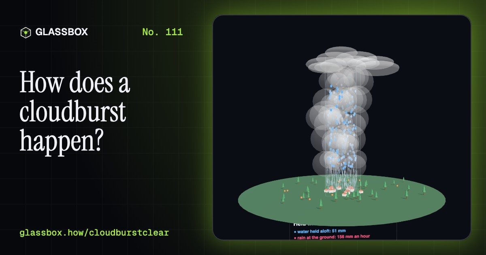
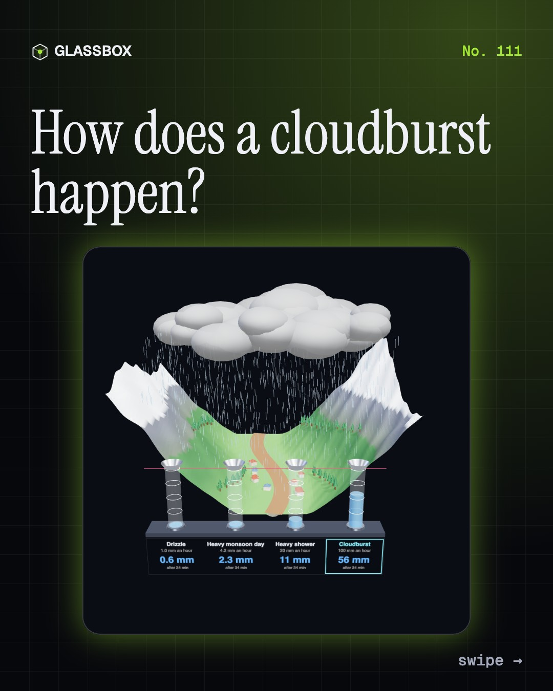
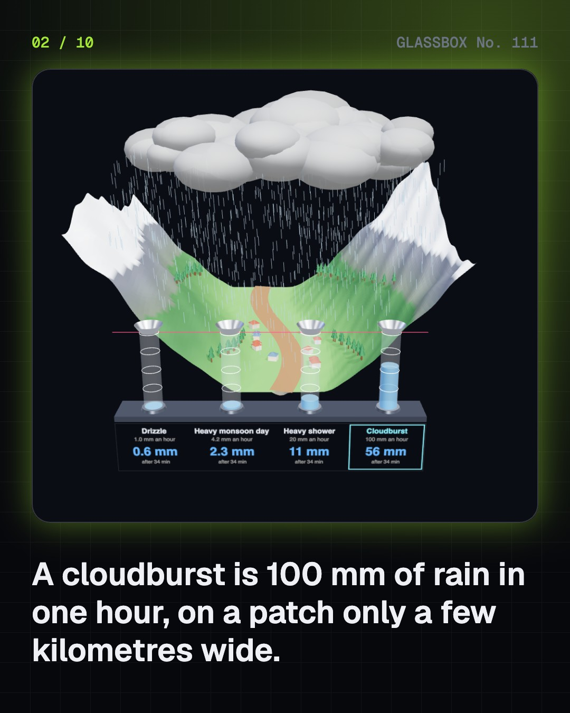
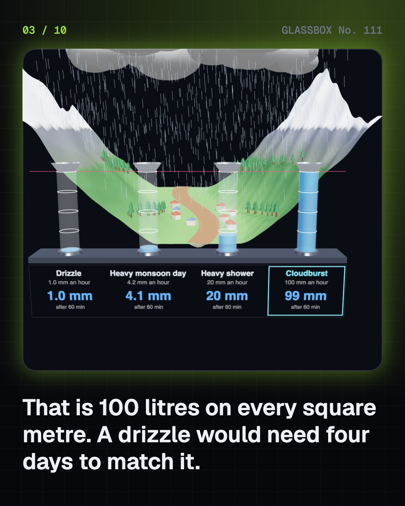
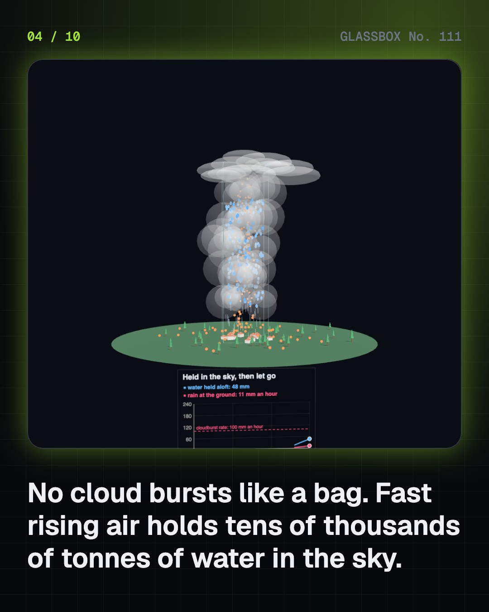

<!-- glassbox:start -->
<!-- Generated from glassbox.json by the Glassbox hub (npm run readme -- cloudburstclear). Edit glassbox.json, not this block. -->
<p align="center"><a href="https://glassbox.how/e/cloudburstclear/"></a></p>

<h1 align="center">CloudburstClear</h1>

<p align="center"><b>How does a cloudburst happen?</b><br>No cloud ever bursts. A cloudburst is a storm whose rising air holds tens of thousands of tonnes of water in the sky and then lets it fall on one small valley: 100 mm in an hour. Fill a rain gauge, hold water aloft and drop it, push monsoon wind up a Himalayan slope, watch a stream become a torrent in minutes, and learn why the only safe move is uphill.</p>

<p align="center"><a href="https://glassbox.how/cloudburstclear/"><b>▶ Play with it</b></a> &nbsp;·&nbsp; <a href="https://glassbox.how/e/cloudburstclear/">Read the 60-second explainer</a> &nbsp;·&nbsp; <a href="https://glassbox.how/cloudburstclear/glassbox/reel.mp4">Watch the 40-second video</a></p>

<p align="center">
  <a href="https://glassbox.how/e/cloudburstclear/"></a>
  <a href="https://glassbox.how/e/cloudburstclear/"></a>
  <a href="LICENSE"></a>
  <a href="LICENSE-CONTENT.md"></a>
  <a href="#privacy"></a>
</p>

## In 60 seconds

1. **An hour of rain like a month.** The India Meteorological Department calls it a cloudburst when a place gets 100 mm of rain or more in one hour. That is 100 litres on every square metre, usually over a patch of only 20 to 30 square kilometres. Leh normally gets about that much in a year. A heavy monsoon day can bring the same 100 mm, but spread over 24 hours.
2. **No cloud bursts.** A cloud is not a bag of water. A big raindrop falls at about 8 metres a second, so an updraft rising that fast holds it up. A strong storm can hold tens of millimetres of water aloft, tens of thousands of tonnes over each square kilometre. When the updraft weakens or the load gets too heavy, it falls together. The whole column of monsoon air holds only 50 to 70 mm of vapour, so the storm must keep pulling moist air in.
3. **Why mountains make them.** Rain at one place is the rate times how long it lasts. A 10 m/s monsoon wind meeting a 20° slope is forced up at more than 3 m/s, which wrings out over 100 mm an hour. On the plains that storm drifts on and a village gets 20 mm. In a valley it stalls, and one place takes the whole hour.
4. **From sky to stream.** Thin soil soaks up perhaps 15 mm an hour. In a cloudburst the other 85 runs off. On a steep 10 square kilometre catchment it all reaches the valley mouth in about 23 minutes: more than 200 cubic metres a second in a stream you could step across. In steep gullies it picks up mud and boulders and becomes a debris flow.
5. **Hard to see coming.** A cloudburst is a few kilometres wide and over within the hour. With rain gauges 30 km apart, a 5 km storm lands on one only about 2 times in 100, and a forecast model with a 12 km grid cannot draw it. Doppler weather radar sees the storm itself out to about 100 km, which allows a warning an hour or two ahead. A glacial lake outburst flood and widespread extreme rain are different things.
6. **India, and staying safe.** Leh 2010, Kedarnath 2013, Amarnath 2022, Himachal Pradesh 2023, Dharali and Chashoti 2025: the storms are old, but more roads, hotels and camps now stand in stream beds and on fans. Never camp or build in a stream bed. Heed IMD red alerts. At a sudden roar or a muddy rise in the stream, move uphill at once, away from the channel. Emergency 112, NDMA 1078.

## Words worth knowing

| Term | Meaning |
|---|---|
| **Cloudburst** | Rain of 100 mm or more in one hour at a place, usually over only a few kilometres (IMD). |
| **Rain rate** | How fast rain falls, in millimetres an hour. One millimetre is one litre on every square metre. |
| **Updraft** | The rising air inside a storm. If it rises as fast as raindrops fall, it holds them up. |
| **Precipitable water** | The depth of water you would get by condensing all the vapour in the air above a place. |
| **Orographic lift** | Air forced to rise because a mountain is in its way. |
| **Run-off** | Rain that falls faster than the ground can soak it up and flows over the surface. |
| **Flash flood** | A flood that rises within minutes to a few hours of the rain that causes it. |
| **Debris flow** | A fast flow of water thick with mud, rock and wood, usually down a steep gully. |
| **Nowcast** | A forecast for the next few hours, made from what radars, satellites and gauges see right now. |

## A short history

**From a word for a bursting cloud to radars on Himalayan ridges: how people learned what a cloudburst really is, and how to get out of its way.**

- **1817** · The word 'cloudburst' appears
- **1908** · The Musi floods Hyderabad (M. Visvesvaraya, Hyderabad)
- **1946** · The Thunderstorm Project (Horace Byers and Roscoe Braham, Orlando, Florida, and Wilmington, Ohio)
- **1947** · Holt, Missouri: 305 mm in 42 minutes
- **1976** · The Big Thompson Canyon flood
- **1996** · The ingredients of a flash flood (Charles Doswell, Harold Brooks and Robert Maddox, Norman, Oklahoma)
- **2005** · Mumbai: 944 mm in a day
- **2010** · Leh, Ladakh

The full story, with 29 moments, charts, people and 83 sources: [glassbox.how/e/cloudburstclear/history](https://glassbox.how/e/cloudburstclear/history/). The data lives in [`history.json`](history.json).

## Video and slides

Made with the Glassbox studio from this box's storyboard (`window.glassbox.director`). Free to reuse under CC BY 4.0.

<a href="https://glassbox.how/cloudburstclear/glassbox/video.mp4"></a>

<p><a href="glassbox/slide-1.jpg"></a> <a href="glassbox/slide-2.jpg"></a> <a href="glassbox/slide-3.jpg"></a> <a href="glassbox/slide-4.jpg"></a></p>

| File | What | Size |
|---|---|---|
| [`glassbox/reel.mp4`](https://glassbox.how/cloudburstclear/glassbox/reel.mp4) | Reel / Short, with captions and soundtrack | 1080×1920 |
| [`glassbox/video.mp4`](https://glassbox.how/cloudburstclear/glassbox/video.mp4) | YouTube video, with captions and soundtrack | 1920×1080 |
| `glassbox/slide-1…10.jpg` | Instagram carousel | 1080×1350 |
| `glassbox/thumb.jpg` | YouTube thumbnail | 1280×720 |
| `glassbox/cover.jpg` | Share card and repo social preview | 1200×630 |
| [`glassbox/history-reel.mp4`](https://glassbox.how/cloudburstclear/glassbox/history-reel.mp4) | “History in 10 moments” Reel / Short | 1080×1920 |
| `glassbox/history-slide-*.jpg` | History carousel | 1080×1350 |
| `glassbox/post.json` | Post copy and schedule used by the publish kit | |

## Privacy

This box has no accounts and no ads, and it ships its own fonts and libraries. When you run it yourself it sends nothing anywhere. On glassbox.how, the site's `/bar.js` also loads Glassbox's analytics: **Google Analytics** to count visits (it asks first in the EU, UK and Switzerland, and stays off when your browser sends Global Privacy Control or Do Not Track) and **ClickTrust** to detect bots.

It remembers a few things **in your own browser only**, and never sends them anywhere:

| Browser storage key | What it holds |
|---|---|
| `cloudburstclear.v1` | Which chapters you have opened, your best quiz scores, and sound on or off. |

Exactly what each one sees is at [glassbox.how/privacy](https://glassbox.how/privacy/).

## Licences

- **Code:** [MIT](LICENSE). Use it, change it, ship it.
- **Explanations, text, images and videos** (`glassbox.json`, `glassbox/`): [CC BY 4.0](LICENSE-CONTENT.md). Credit “Glassbox, glassbox.how/e/cloudburstclear”.
- **Third-party parts** keep their own licences: [three.js](https://threejs.org) (MIT), [Geist, Instrument Serif](https://openfontlicense.org) (SIL OFL 1.1).
- The Glassbox name and logo aren't covered by either licence. See the [terms](https://glassbox.how/terms/).

Found a mistake? [Open an issue](https://github.com/bdeeps/cloudburstclear/issues). Corrections happen in public.
<!-- glassbox:end -->

## Run it

It's plain HTML, CSS and JavaScript. No build step and no dependencies. Run locally, it contacts no other website.

```bash
python3 -m http.server 8000
```

Three.js and the fonts ship in `vendor/` and `fonts/`, so it also works offline.

Then open http://localhost:8000.

## How it's built

| File | What |
|---|---|
| `index.html`, `css/app.css` | The page and its styles |
| `js/app.js`, `js/stage.js`, `js/ui.js`, `js/kit.js` | The shared Glassbox 3D engine: chapters, 3D stage, controls, quiz, video director |
| `js/burst.js` | Shared physics (rain rate, precipitable water, run-off, Kirpich, Manning) and drawing helpers (terrain, streams, rain, clouds, chart boards) |
| `js/chapters/*.js` | One file per chapter: the 3D model, controls, text, key terms, quiz and video scenes |
| `glassbox.json` | Title, question, explainer beats, key terms, browser storage and credits shown on glassbox.how |
| `reel` in each chapter | The storyboard the Glassbox studio records into short videos |
| `glassbox/` | The published video, slides, thumbnail and post copy |
| `fonts/`, `vendor/three/` | Self-hosted Geist and Instrument Serif (SIL OFL 1.1) and three.js (MIT) |
